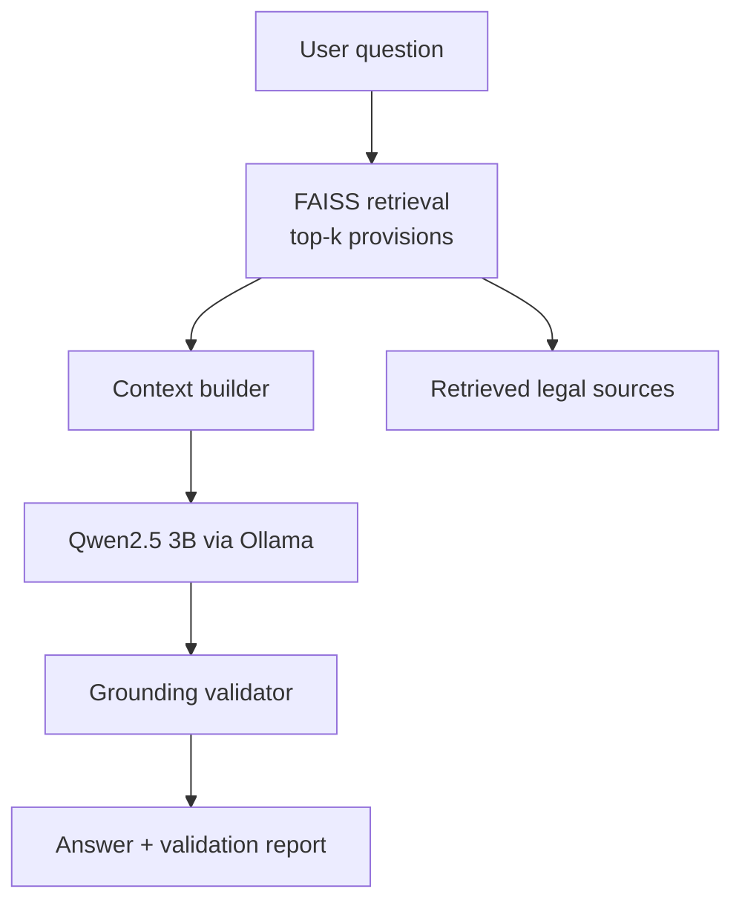

# Legal RAG: Consumer Protection Act, 2019

A fully local, retrieval-augmented question answering system for Indian consumer law. Ask a question in plain English and get an answer grounded in the text of the **Consumer Protection Act, 2019**, along with the exact provisions it was drawn from and an automatic check that the answer doesn't cite anything it wasn't given.

> **Disclaimer:** This project is for research and educational purposes. It is not legal advice.

## Highlights

- **Grounded answers.** The LLM only sees retrieved sections of the Act, and the prompt is built around them.
- **Grounding validation.** Every generated answer is checked before it is shown: cited sections must be among the retrieved sections, and the output format is verified.
- **Source transparency.** Each answer is followed by the retrieved provisions with their similarity scores.
- **Runs locally.** FAISS for vector search and Qwen2.5 3B served by Ollama, so no API key and no data leaves your machine.

## How it works



1. **Retrieve:** the question is embedded and the top 5 matching chunks of the Act are fetched from a FAISS index.
2. **Build context:** the chunks (section number, title, text) are assembled into a prompt context.
3. **Generate:** a local Qwen2.5 3B model (via Ollama, temperature 0.1) writes the answer.
4. **Validate:** the answer is checked for the following.

   | Check | What it catches |
   | --- | --- |
   | Section grounding | Cited sections that were not in the retrieved context |
   | Output format | Missing required headers (Answer, Relevant Sections, Explanation, Sources) |
   | Reasoning leakage | Internal reasoning appearing in the answer |
   | Thinking tags | Stray `<think>`-style tags |
   | Template placeholders | Unfilled prompt-template placeholders |

5. **Display:** validation status, the cleaned answer, then the retrieved sources.

## Project structure

```
legal_RAG/
├── data/               # Source legal text
├── ingestion/          # Scripts that turn the Act into chunks and embeddings
├── vectorstore/        # FAISS index and chunk metadata (cpa_2019.index, cpa_2019_metadata.json)
├── retrieval/          # LegalRetriever (embedding + FAISS search), context builder
├── generation/         # Answer generator (Ollama), grounding validator, context helpers
├── scripts/            # Helper and utility scripts
├── main.py             # Interactive CLI application
├── rag_pipeline.py     # LegalRAGPipeline class: question -> answer, sources, retrieved results
└── requirements.txt
```

## Getting started

### Prerequisites

- Python 3.10+
- [Ollama](https://ollama.com) installed and running

### Installation

```bash
git clone https://github.com/satyams8092/legal_RAG.git
cd legal_RAG

python -m venv venv
source venv/bin/activate        # Windows: venv\Scripts\activate

pip install -r requirements.txt
pip install faiss-cpu sentence-transformers   # retrieval dependencies
```

### Pull the model

```bash
ollama pull qwen2.5:3b
ollama serve                    # skip if Ollama is already running
```

### Build the index

The app expects the FAISS index and metadata at:

```
vectorstore/cpa_2019.index
vectorstore/cpa_2019_metadata.json
```

If they are not already in the repo, generate them with the scripts in `ingestion/`.

### Run

```bash
python main.py
```

Type a question at the prompt. Type `exit`, `quit` or `q` to leave.

## Example session

```
> What remedies does a consumer have against a defective product?

----------------------------------------------------------------------
GROUNDING VALIDATION
----------------------------------------------------------------------
Status: PASS

----------------------------------------------------------------------
LEGAL RAG ANSWER
----------------------------------------------------------------------
Answer: ...
Relevant Sections: ...
Explanation: ...
Sources: ...

----------------------------------------------------------------------
RETRIEVED LEGAL SOURCES
----------------------------------------------------------------------
1. Section ... — ... (similarity: 0.xxxx)
```

## Configuration

Settings live at the top of `main.py`:

| Setting | Default | Description |
| --- | --- | --- |
| `OLLAMA_MODEL` | `qwen2.5:3b` | Local model used for generation |
| `OLLAMA_URL` | `http://localhost:11434` | Ollama server address |
| `TOP_K` | `5` | Number of chunks retrieved per question |
| `INDEX_PATH` | `vectorstore/cpa_2019.index` | FAISS index |
| `METADATA_PATH` | `vectorstore/cpa_2019_metadata.json` | Chunk metadata |

## Troubleshooting

- **"Ollama is not running"**: start it with `ollama serve`.
- **"Ollama model 'qwen2.5:3b' was not found"**: run `ollama pull qwen2.5:3b`.
- **"FAISS index was not found"**: build the index with the scripts in `ingestion/` and check the paths above.

## Roadmap

- Extend the knowledge base to other Indian Bare Acts, such as the Indian Contract Act, 1872
- Compare retrieval strategies: BM25, dense, hybrid, and cross-encoder reranking
- Evaluate answer quality with RAGAS

## Author

**Satyam Shah**, [@satyams8092](https://github.com/satyams8092)
